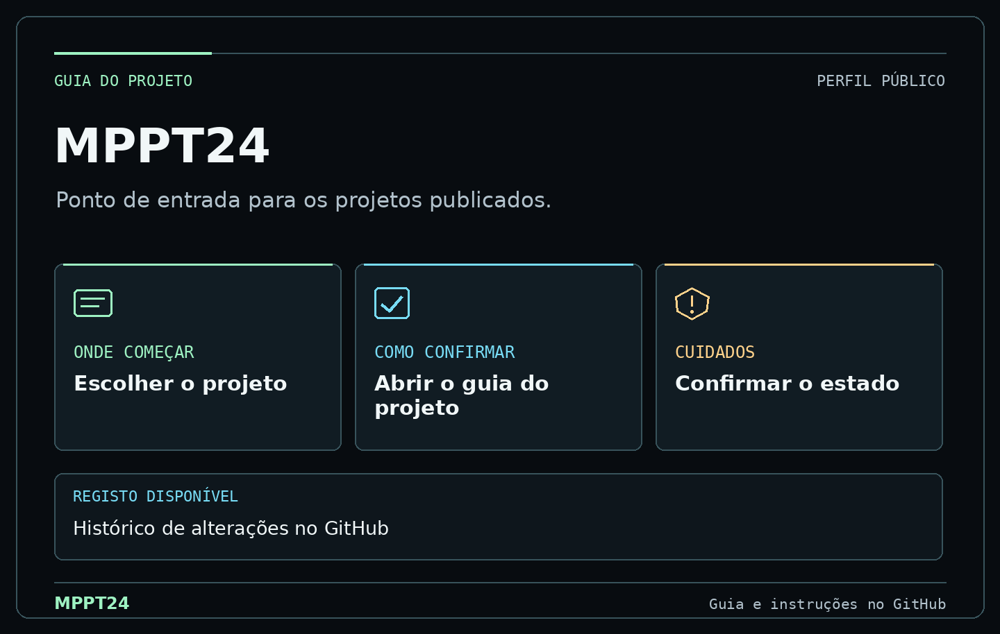

# Guia de MPPT24

**Estado:** Perfil público.

Ponto de entrada para os projetos publicados.

## Onde começar

Abre o [perfil público](https://github.com/mppt24) e escolhe uma opção em «Por onde começar». Todos os guias públicos continuam no [catálogo do MPPT24OS](https://github.com/mppt24/MPPT24OS/blob/main/GUIA.md#guias-dos-reposit%C3%B3rios-p%C3%BAblicos).

## Como confirmar

Segue a ligação do projeto para ler o seu README e a secção de primeiros passos.

## Como ler os registos

Este repositório serve de perfil. Para ver resultados de testes, consulta **Actions** no repositório do componente.

Para localizar uma alteração, usa a data e a mensagem do commit no histórico Git.

## Cuidados

Confirma o estado do projeto antes de instalar. Os resultados do CORE, do AGI e do AI Hub são independentes.
